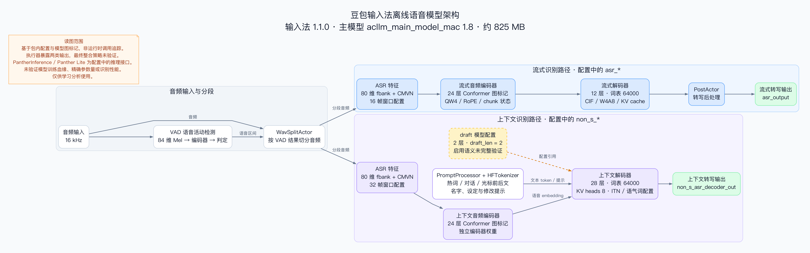

> [!NOTE]
> 仅供学习分析使用。

# 豆包输入法离线语音模型分析

## 核心结论

分析对象是豆包输入法 **1.1.0，build 1** 的主模型 **`acllm_main_model_mac` 1.8**，源包约 **825 MB**。最重要的结果如下：

- **目录密钥由固定种子、包内 12 字节 nonce 和 header size 确定性派生。** 最终目录密钥不是直接写死的常量，已验证的公式不读取账号、钥匙串或服务器。
- **FLUTE v3 目录使用 ChaCha20，内部文件正文使用 XOR 混淆。** 正文的字节位置在每个内部文件起点重置，目录以外的数据也经过处理。
- **全部 20 个内部文件已恢复并通过源包一致性核对。** 包内 MD5 清单另有 5 项匹配、3 项不匹配，差异原因未明。
- **可见结构更接近 Seed-ASR / AcLLM 的路线。** 与 efeslab/LiteASR 的 Whisper 低秩压缩方案存在结构差异，具体代码或权重血缘仍未确认。

> [!IMPORTANT]
> 两个脚本只验证了主模型 1.8。精确参数量、训练来源和 MD5 差异原因尚未确认，上下文辅助模型 1.1 不在本次解包范围内。仓库不提供加密源包、解密权重、应用二进制、内存快照或 LuLu 备份。

阅读入口按用途划分：

- [格式、密钥与校验](model-analysis/FINDINGS.md) 说明派生公式、文件布局和验证限制。
- [模型结构与来源对比](comparison/COMPARISON.md) 区分本机证据、公开路线和未知血缘。
- [文件功能索引](FILE_INDEX.md) 列出每个文件的职责，[发布范围](PRIVACY.md) 说明身份信息和数据边界。
- [复现步骤](#复现目录验证与解包) 给出目录验证、解包和完整输出核对命令。

## 模型架构

主模型 1.8 的音频分段、流式识别与上下文识别路径如下：



蓝色表示流式路径，紫色表示上下文路径，橙色虚线表示 draft 的配置引用。图依据静态配置和模型图标记绘制，运行时启用语义与两类输出的最终整合策略未完整验证。

[查看原图](diagrams/doubao-asr-architecture.png) · [可编辑源码](diagrams/doubao-asr-architecture.dot) · [图例、证据范围与渲染命令](diagrams/README.md)

## 结论与证据

| 项目 | 结果 | 证据 |
| --- | --- | --- |
| 主模型大小 | 824999405 字节，约 825 MB | [环境记录](environment.json) |
| 容器 | FLUTE v3，1143 字节头部，20 个内部文件 | [目录验证](model-analysis/verification.json) |
| 密钥 | 固定种子、12 字节 nonce 和 header size 确定性派生 | [格式与密钥](model-analysis/FINDINGS.md) |
| 正文 | 每个内部文件独立重置偏移的 XOR 混淆 | [解包工具](model-analysis/extract_model.py) |
| 提取完整性 | 20 个文件与源包解码内容一致 | [提取校验报告](model-analysis/extraction-report.json) |
| 包内 MD5 清单 | 5 项匹配、3 项不匹配，原因未明 | [格式与密钥](model-analysis/FINDINGS.md) |
| 可见结构 | 两套 24 层 Conformer 编码器图，12 层流式解码路径、28 层上下文解码路径、64000 词表 | [模型结构与来源对比](comparison/COMPARISON.md) |
| 来源判断 | 与 Seed-ASR / AcLLM 在结构和上下文设计上相似，具体血缘未确认 | [模型结构与来源对比](comparison/COMPARISON.md) |

## 目录职责

```text
doubao-ime-analysis/
├── README.md                    入口、结论与复现命令
├── FILE_INDEX.md                每个文件的核心功能
├── PRIVACY.md                   发布内容和身份信息范围
├── environment.json            分析对象指纹与环境
├── requirements.txt            两个工具的 Python 依赖
├── model-analysis/              密钥与解包代码、关键产物、验证报告
├── model-config/                主模型当前配置与提示模板，供结构分析
├── diagrams/                    模型架构图、可编辑源码与图例
└── comparison/                  公开模型对比、选定结构证据与来源链接
```

逐文件说明见 [FILE_INDEX.md](FILE_INDEX.md)。`model-config/` 只保留分析需要的配置和提示。配置中的权重、CMVN 和 tokenizer 路径指向原模型包，仓库未提供这些依赖，因此该目录不能独立运行推理。

## 复现目录验证与解包

### 1. 准备源包与依赖

从仓库根目录执行命令。运行前需要：

- Python 3.11 或更新版本，本次验证使用 Python 3.12.12。
- 本机已有主模型 1.8 的源包。
- 若执行完整提取，另留约 825 MB 空间，目标目录必须不存在。

源包默认位置为：

```text
~/Library/Application Support/DoubaoIme/ASRModel/versions/1_8/asr_model.model
```

安装依赖。公开仓库不需要 Git LFS、Unicorn 或 Capstone。

```sh
python3 -m pip install -r requirements.txt
```

### 2. 验证目录与派生密钥

重新派生密钥，并与分析时原指令模拟生成的目录逐字节比较：

```sh
python3 model-analysis/verify_directory.py \
  --reference-directory model-analysis/emulated-directory.bin
```

预期结果如下：

| 检查 | 预期结果 |
| --- | --- |
| `candidate_verified` | `true` |
| counter 1 的 `valid` 和 `matches_reference` | 均为 `true` |
| counter 0 | 对照失败 |
| 目录 SHA-256 | `07e0a4590ced10d7fc0b094ea8ca948f1df61fb4e9e80f218373b5f67985b991` |

### 3. 提取全部内部文件

提取到不存在的新目录：

```sh
mkdir -p .local-data
python3 model-analysis/extract_model.py .local-data/extracted-model
```

### 4. 核对完整输出

重新核对上一步生成的完整目录：

```sh
python3 model-analysis/extract_model.py --verify-only .local-data/extracted-model
```

预期全部 20 个文件通过源包一致性核对，同时报告包内 MD5 清单的 5 项匹配和 3 项差异。

> [!IMPORTANT]
> 成功退出只表示提取及落盘核对通过，不表示全部包内 MD5 项都匹配。`--verify-only` 需要完整解包目录，不能对不含权重的 `model-config/` 运行全量核对。

输出和报告的处理规则如下：

- `--verify-only` 会更新输出目录的 `extraction-report.json`。
- `.local-data/` 和所有 `.pthlite` 文件均由 `.gitignore` 排除。
- 仓库中的校验报告是分析结果，不会因上述命令自动覆盖。

## 分析环境与范围

| 项目 | 本次分析环境 |
| --- | --- |
| 分析时间 | 2026-11-09 至 2026-11-10 |
| 输入法 | 豆包输入法 1.1.0，build 1 |
| 主模型 | `acllm_main_model_mac` 1.8 |
| 包内配置标签 | `LiteASRP_v1.1.2_6`，与输入法应用版本不同 |
| 系统 | macOS 27.2，build `26B123` |
| 硬件 | MacBook Air，Apple M5，ARM64，16 GB 内存 |
| Python | Miniforge Python 3.12.12 |
| 运行依赖 | NumPy 2.3.5、PyCryptodome 3.23.0 |

完整应用指纹和分析工具版本见 [environment.json](environment.json)。

验证方法与范围如下：

- 密钥来源通过独立分析进程及 ARM64 模拟检查，再用标准 ChaCha20 和源包正文核对。
- 原安装应用和模型保持只读，没有附加或修改原输入法进程。
- 公开仓库支持独立目录验证和解包，不包含保护虚拟机或原指令模拟的重放材料。[生成验证记录](model-analysis/generation-verification.json) 保存真实和合成元数据案例的原分析结果。
- 结构对比基于当前配置、五个模型文件各自前 4 MiB 的字符串证据、应用静态算子标记，以及分析时采集的公开资料。
- 可见图名称和配置不能证明精确参数量、实际识别性能或训练来源。上下文辅助模型 `acllm_context_model_mac` 1.1 不在本次解包范围内。

用户名路径和提交身份的处理见 [PRIVACY.md](PRIVACY.md)。
