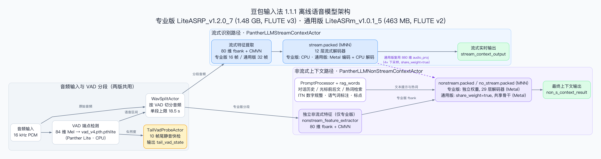

# 豆包输入法 macOS 离线语音模型分析

> [!NOTE]
> **本分支（`main`）对应最新版本 macOS `1.1.2`**；旧版产物见 Git Tag（如 `git checkout tags/macos_1.1.0`）。本仓库仅用于技术学习与安全/架构研究，使用前请阅读[合规与使用边界](#合规与使用边界)。

## 核心结论

豆包输入法 macOS `1.1.2` 将离线语音识别拆分为 **专业版**（1.48 GB）和 **通用版**（463 MB）两套模型，另配 108 MB 上下文辅助词典：

- **打包方式大改**：不再像 1.1.0 那样散放 20 个 `.pthlite` 文件，而是收拢为 **6 个文件**。核心 ASR 引擎改用 MNN（`.mnn`），打包进 `stream.packed` 与 `nonstream.packed` / `no_stream.packed`；只有 VAD 仍保留 `vad_v4.pth.pthlite`，且专业版与通用版的 VAD、fbank、CMVN 三个文件完全相同。
- **双模型架构分工**：
  - **专业版（`LiteASRP_v1.2.0_7`）**：流式与非流式权重完全独立（`share_weight: false`），非流式独立抽特征并走 Apple Metal GPU 加速。
  - **通用版（`LiteASRm_v1.0.1_5`）**：流式与非流式共享骨干权重（`share_weight: true`），非流式直接复用流式输出的 880 维音频特征，体积不到专业版三分之一。
- **容器与还原算法**：
  - **专业版用 FLUTE v3**：目录表使用 ChaCha20（Counter 1）加密，密钥由客户端固定 32 字节种子、包内 12 字节 Nonce 和 Header Size 确定性算出，不联网也不读账号信息。
  - **通用版用 FLUTE v2**：目录表**明文存储**，从偏移 21 字节起直接读取。
  - **正文混淆统一**：v2 与 v3 的内部文件正文都用同一条按文件内相对偏移计算的 XOR 公式还原：`P[i] = C[i] ^ b"symphony"[i % 8] ^ (i & 255)`。
- **离线下载与断网运行**：官方模型托管在 `byteeffecttos.com` CDN，配置 LuLu 防火墙仅放行 `effect.snssdk.com:443` 和 `*.byteeffecttos.com:443` 即可正常下载更新；下完后彻底断网，离线转写照常工作。

## 1.1.2 模型速览

| 项目 | 专业版 (`acllm_pro_model_mac`) | 通用版 (`acllm_general_model_mac`) | 上下文辅助 (`acllm_context_model_mac`) |
| :--- | :--- | :--- | :--- |
| **版本 / 标签** | `1.5` / `LiteASRP_v1.2.0_7` | `1.8` / `LiteASRm_v1.0.1_5` | `1.1` |
| **源包大小** | 1,487,023,817 B (~1.48 GB) | 463,455,256 B (~463 MB) | 108,300,553 B (~108 MB) |
| **源包 MD5** | `4f19c90670291b502a4dd34b936e5f2f` | `a6846b0a91ac8a9579468e252c1da2e5` | `32c387bc13445d1b020077c168c0d2c9` |
| **容器格式** | FLUTE v3（343 B Header，6 文件） | FLUTE v2（331 B Header，6 文件） | ZIP（词典 / NER / 拼音） |
| **目录加密** | ChaCha20（种子 + Nonce 派生） | 明文无加密 | 无 |
| **权重策略** | 流式 / 非流式独立；非流式走 Metal | 共享骨干权重；复用 880 维音频特征 | 静态词典与辅助模型 |
| **验证 / 解包报告** | [验证](model-analysis/verification-pro.json) · [解包](model-analysis/extraction-report-pro.json) | [验证](model-analysis/verification-general.json) · [解包](model-analysis/extraction-report-general.json) | 见 [下载文档](OFFLINE_MODEL_DOWNLOAD.md) |

> 1.1.0 旧版单模型（`acllm_main_model_mac` 1.8，825 MB，20 个文件）的完整分析与产物保留在 Tag `macos_1.1.0`。

## 文档导航

- [格式、密钥与内部文件清单](model-analysis/FINDINGS.md)：FLUTE v2/v3 二进制结构、密钥派生步骤、XOR 还原与 1.1.2 全部内部文件哈希。
- [离线模型直链与 LuLu 规则](OFFLINE_MODEL_DOWNLOAD.md)：官方 CDN 下载直链、调度接口参数与防火墙最小放行/阻断清单。
- [模型架构与公开路线对比](comparison/COMPARISON.md)：1.1.2 双模型配置差异，以及与 Seed-ASR / LiteASR / 实时语音模型的对比。
- [文件索引](FILE_INDEX.md) · [发布范围、隐私与合规](PRIVACY.md) · [架构图说明](diagrams/README.md)

## 模型架构图

下图基于 1.1.2 两款模型的配置文件（[专业版](model-config/pro-config.yaml) / [通用版](model-config/general-config.yaml)）与 `.packed` 内部结构绘制，展示 VAD + 尾静音快检、流式实时路径，以及专业版独立权重与通用版共享骨干的差异：



[查看原图](diagrams/doubao-asr-architecture.png) · [Graphviz 源码](diagrams/doubao-asr-architecture.dot) · [图例与渲染命令](diagrams/README.md)

## 复现步骤

仓库不提供模型源包或权重，需先在本机豆包输入法中下载离线模型。工具同时兼容 1.1.2 专业版、通用版和 1.1.0 旧版模型。

### 1. 安装依赖（Python 3.11+）

```sh
python3 -m pip install -r requirements.txt
```

### 2. 验证容器目录与密钥派生

不传 `--model` 时会自动读取 `offline_model_active_layout.json` 检测当前激活的模型：

```sh
# 自动检测当前激活模型
python3 model-analysis/verify_directory.py

# 显式验证 1.1.2 专业版
python3 model-analysis/verify_directory.py \
  --model "$HOME/Library/Application Support/DoubaoIme/ASRModel/versions/acllm_pro_model_mac/1_5_4f19c90670291b502a4dd34b936e5f2f/asr_model.model"

# 显式验证 1.1.2 通用版
python3 model-analysis/verify_directory.py \
  --model "$HOME/Library/Application Support/DoubaoIme/ASRModel/versions/acllm_general_model_mac/1_8_a6846b0a91ac8a9579468e252c1da2e5/asr_model.model"
```

### 3. 流式解包并校验

工具以 4 MiB 分块流式还原，解包后自动逐文件回读核对大小与 SHA-256：

```sh
# 解包专业版（约需 1.5 GB 空间）
python3 model-analysis/extract_model.py \
  --model "$HOME/Library/Application Support/DoubaoIme/ASRModel/versions/acllm_pro_model_mac/1_5_4f19c90670291b502a4dd34b936e5f2f/asr_model.model" \
  .local-data/extracted-pro

# 解包通用版（约需 500 MB 空间）
python3 model-analysis/extract_model.py \
  --model "$HOME/Library/Application Support/DoubaoIme/ASRModel/versions/acllm_general_model_mac/1_8_a6846b0a91ac8a9579468e252c1da2e5/asr_model.model" \
  .local-data/extracted-general

# 仅核对已解包目录与源包是否逐字节一致（不写入）
python3 model-analysis/extract_model.py --verify-only \
  --model "$HOME/Library/Application Support/DoubaoIme/ASRModel/versions/acllm_pro_model_mac/1_5_4f19c90670291b502a4dd34b936e5f2f/asr_model.model" \
  .local-data/extracted-pro
```

## 目录结构

```text
doubao-ime-analysis/
├── README.md                   入口、核心结论与复现命令
├── AGENTS.md                   AI Agent 版本更新流程与校验门禁
├── UPDATE_PROMPT.md            新版发布时的一键复用更新 Prompt
├── OFFLINE_MODEL_DOWNLOAD.md   官方 CDN 直链、调度接口与 LuLu 规则
├── FILE_INDEX.md               全部 31 个文件的职责索引
├── PRIVACY.md                  公开范围与身份脱敏说明
├── environment.json            1.1.2 应用指纹与分析环境
├── requirements.txt            Python 依赖（numpy / pycryptodome）
├── scripts/                    本机安装盘点与仓库一致性/隐私校验脚本
├── model-analysis/             FLUTE v2/v3 验证与解包脚本、种子与校验报告
├── model-config/               专业版 / 通用版配置与 fbank 参数
├── diagrams/                   架构图与 Graphviz 源码
└── comparison/                 双模型对比、静态标记与公开资料链接
```

## 分析环境

| 项目 | 详情 |
| :--- | :--- |
| **目标应用** | 豆包输入法 macOS `1.1.2`（Build `1`，Wave `1.1.2.2`，Build Number `1010202`） |
| **主程序 SHA-256** | `c36348f714eb4e9883487d1b7b96e1ad5e57d1d13545da084173b4785173df7b` |
| **测试环境** | macOS 27.2.1 (`26B131`) · MacBook Air Apple M5 (16 GB) · Python 3.12.12 |
| **运行依赖** | `numpy==2.3.5` · `pycryptodome==3.23.0` |

完整指纹见 [environment.json](environment.json)。

## 合规与使用边界

- **研究与学习用途**：本仓库仅记录本地客户端及离线模型的技术结构分析，不代表任何官方立场，不构成法律或安全背书。
- **不分发受版权保护资产**：仓库仅公开分析文档、配置结构与验证脚本，不提供、不镜像、不二次分发任何模型权重、加密源包或应用程序二进制。
- **反对滥用**：维护者明确不支持将本项目用于商业集成、绕过软件授权/付费限制、批量抓取官方 CDN、恶意篡改或任何违反适用法律法规及原软件服务条款的行为；使用者需自行评估并承担合规责任。
- **权利与移除**：文中涉及的商标、产品名及协议结构归原权利人所有。如权利方认为仓库中任何内容存在侵权或不当之处，请通过 Issue 联系，核实后将及时处理或移除。

更细致的资产边界与脱敏原则见 [PRIVACY.md](PRIVACY.md)。
